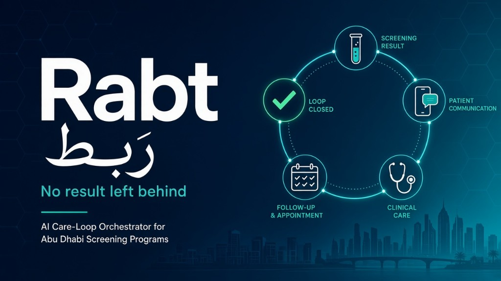
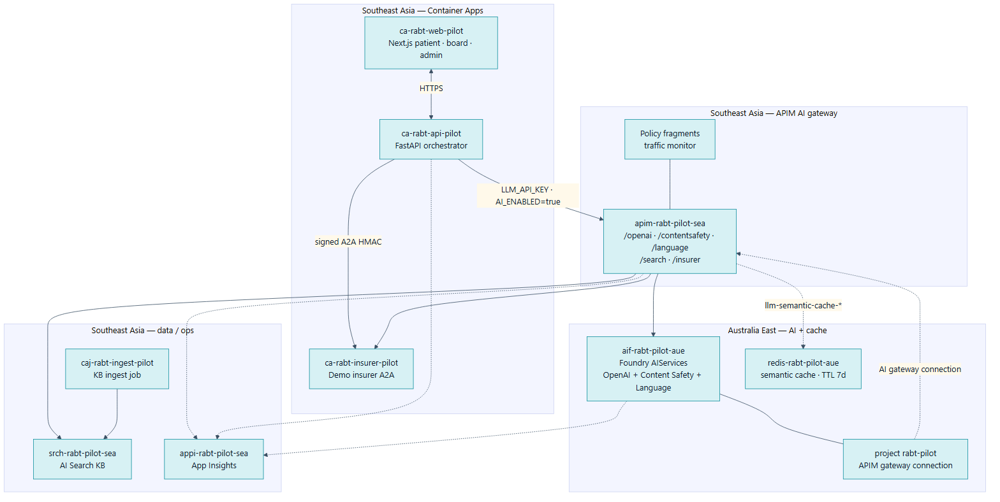
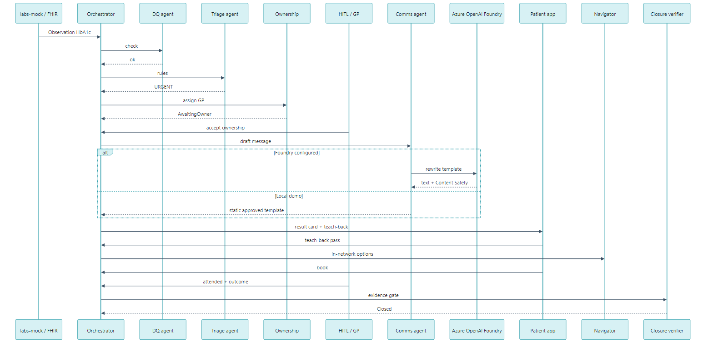
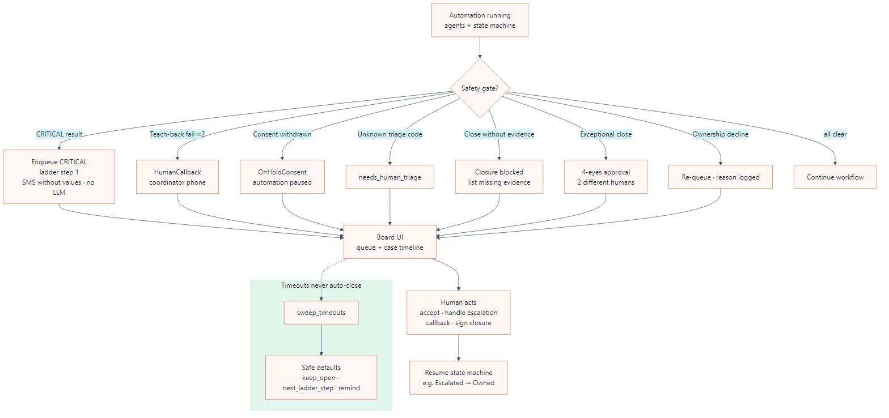
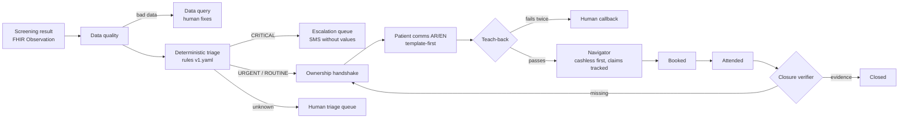

# Rabt – AI Care-Loop Orchestrator for Abu Dhabi Screening Programs



**Rabt: no result left behind.**  ·  Rabt (ربط) means "link" or "connection" in Arabic.

> **Prototype for the Future Health Digital Innovation Challenge.** Population Health track, challenge *Closing the Screening-to-Care Loop*.
> **Synthetic data only. Not a medical device. It does not diagnose or prescribe.** Clinical thresholds and time limits are illustrative and need clinician / DoH Abu Dhabi sign-off.

| Link | URL |
|---|---|
| Demo video | https://youtu.be/Qe9OF5uIzyg |
| Repo | https://github.com/suhail39ahmed/rabt-care-loop |
| **Pilot web (Azure)** | https://ca-rabt-web-pilot.salmonwave-97737d51.southeastasia.azurecontainerapps.io |
| **Pilot API** | https://ca-rabt-api-pilot.salmonwave-97737d51.southeastasia.azurecontainerapps.io · [`/healthz`](https://ca-rabt-api-pilot.salmonwave-97737d51.southeastasia.azurecontainerapps.io/healthz) · [`/docs`](https://ca-rabt-api-pilot.salmonwave-97737d51.southeastasia.azurecontainerapps.io/docs) |
| Azure IaC | Terraform in [`infra/terraform`](infra/terraform) + GitHub Actions ([Deploy / hosting](#deploy--hosting)) |

## Pilot on Azure (live)

Guest demo — no login. Board writes use the persona switcher (`X-Rabt-Persona`). AI is **on** (`AI_ENABLED=true`): Comms / RAG / translate go through the APIM AI gateway to Foundry.

| Component | Name | URL / notes |
|---|---|---|
| Web (Next.js) | `ca-rabt-web-pilot` | https://ca-rabt-web-pilot.salmonwave-97737d51.southeastasia.azurecontainerapps.io |
| API (FastAPI) | `ca-rabt-api-pilot` | https://ca-rabt-api-pilot.salmonwave-97737d51.southeastasia.azurecontainerapps.io |
| Demo insurer (A2A) | `ca-rabt-insurer-pilot` | https://ca-rabt-insurer-pilot.salmonwave-97737d51.southeastasia.azurecontainerapps.io (scales to zero when idle) |
| APIM AI gateway | `apim-rabt-pilot-sea` | https://apim-rabt-pilot-sea.azure-api.net — APIs: `/openai`, `/contentsafety`, `/language`, `/search`, `/insurer` |
| Foundry (AIServices) | `aif-rabt-pilot-aue` · project `rabt-pilot` | Australia East — OpenAI + Content Safety + Language behind APIM (no standalone CS account) |
| Semantic cache | `redis-rabt-pilot-aue` + APIM cache `semantic-cache` | Opt-in via `x-rabt-cacheable: true`; score threshold `0.15`; TTL **7 days** |
| AI Search KB | `srch-rabt-pilot-sea` | Hybrid + semantic ranker |
| App Insights | `appi-rabt-pilot-sea` | API + APIM + Foundry diagnostics (no body logs) |
| Resource group | `rg-rabt-pilot-sea` | Primary region Southeast Asia; Foundry + Redis in Australia East |

Architecture (Azure pilot):



More: [docs/foundry-ai.md](docs/foundry-ai.md) · [docs/ai-monitoring.md](docs/ai-monitoring.md) · [infra/terraform/README.md](infra/terraform/README.md)

## Try it in 90 seconds

Open the **[pilot web](https://ca-rabt-web-pilot.salmonwave-97737d51.southeastasia.azurecontainerapps.io)** above, or run locally ([Quick start](#quick-start): `make api` / `make web`, or `.\scripts\dev-api.ps1` / `.\scripts\dev-web.ps1`). No login. Guest reads are open. Board writes use the persona switcher (`X-Rabt-Persona`). **Reset demo** on `/board` restores the seed.

**Wow path (pitch hero):** Ravi’s abnormal FIT → cashless network option → one-tap book → same case on the coordinator board.

1. **FIT / cashless (EN)** — `http://localhost:3000/patient/case-gc05-fit?lang=en`: teach-back if needed → book the **cashless** network option.
2. **Board** — `/board`: find Ravi’s case as Coordinator Sara / Dr Khan (persona switcher).
3. **Patient card (AR)** — Fatima at `/patient/case-gc01-fatima`: “not a diagnosis” + RTL teach-back.
4. **Critical / HITL** — board: critical BP ladder (**Advance +15m**) or two-person close with a second persona.
5. **Admin KPIs** — `/admin`: false closures and critical recall on the synthetic seed (one proof number).
6. **Insurer agent** — `/insurer`: A2A with Demo Health Insurance (signed, schema-checked).
7. **API** — OpenAPI at `http://localhost:8000/docs` (`/healthz`, `/demo`, `/cases/{id}`).

| Real in this demo | Mocked / optional / off |
|---|---|
| FHIR-shaped Observation intake (local/SQLite) | Malaffi HIE and Sehatna patient app |
| Deterministic triage, navigator, closure, HITL board | — |
| Azure OpenAI via APIM AI gateway (`AI_ENABLED=true` on the pilot) | Kill switch can turn LLM paths back to templates |
| Lexicon / no-diagnosis guardrails, regex PII scrubbing before any model call | — |
| Azure Content Safety + Prompt Shields + Language PII (via Foundry behind APIM) | Fail closed → approved templates |
| Grounded answers from the approved KB (local BM25; Azure AI Search in Azure), clinician-approved learning loop | Demo Health Insurance is a **synthetic** payer |
| Signed A2A with a separate insurer agent; strict reply validation | MCP tool servers (prototype — **not** on the demo path) |
| Live EN↔AR translation (approved phrases; AI with placeholders when on), browser TTS | |

CI runs on every pull request and on `main`: ruff, pytest (golden cases included), the seeded benchmark, pip-audit, gitleaks, npm audit, the web build, both Docker builds, Terraform checks (fmt, validate, `terraform test`, tflint, checkov) and a Playwright end-to-end story.

Loop overview:






---

## The problem

Population screening programmes find abnormal results such as raised HbA1c, critical blood pressure, a positive FIT or an abnormal cervical screen. The loop often leaks between the result and the follow-up care:

- nobody clearly owns the result
- the patient doesn't understand what to do next
- the suggested provider is outside the patient's insurance network
- referrals are rejected or patients don't attend
- cases are closed or forgotten without proof that care happened

## The solution

Rabt is an ownership and navigation layer that sits on top of FHIR-style data. Every actionable screening result becomes an **owned, time-boxed, insurance-aware case** that:

1. is checked for data quality and triaged by **versioned deterministic rules** (no LLM)
2. is handed to a named owner through an **accept/decline ownership handshake**, or goes straight to a **critical escalation queue**
3. is explained to the patient in **Arabic or English** using approved templates, with a "not a diagnosis" banner
4. confirms understanding with **teach-back** questions; two failures trigger a human callback
5. offers follow-up options ranked by a deterministic navigator, each with a **payment path**: cashless at a network hospital first, pay-and-claim reimbursement (with a tracked claim) when the plan covers it, and out-of-network only when reimbursable or explicitly self-pay
6. **closes only with evidence** (attended encounter + outcome) or through a recorded human decision

Each timeline entry is labelled **fact**, **calculated** or **AI**, so reviewers can see what produced it.

## How Rabt works




The case lifecycle is a **state machine** with 20 states and an explicit allowed-transition table (`services/orchestrator/app/state_machine.py`). Illegal moves raise an error, and `Closed` needs verified evidence. Each state maps to a FHIR `Task.status`.

## Agents and roles

The **Coordinator** (`services/orchestrator/app/coordinator.py`) is the supervisor. It delegates each step to a specialist agent through a typed Pydantic contract (`DelegationResult` in `app/contracts.py`) and applies the proposed transition only if the state machine allows it.

| Agent | Path | Decides with | Role |
|---|---|---|---|
| Data Quality | `services/agents/data_quality/` | Deterministic | Missing units and contradictory repeats → data query |
| Triage | `services/agents/triage/` | Deterministic YAML rules | Urgency + pathway; unknown → human |
| Ownership | `services/agents/ownership/` | Deterministic | Assigns an owner who must accept or decline |
| Escalation | `services/agents/escalation/` | Deterministic, **no LLM** | Critical ladder; patient SMS never contains values |
| Patient Comms | `services/agents/comms/` | Approved templates; LLM optional | AR/EN message + teach-back |
| Navigator | `services/agents/navigator/` | Deterministic scoring | Ranks providers with a payment path per option: cashless at network hospitals first, pay-and-claim reimbursement when the plan offers it, out-of-network excluded unless reimbursable or explicit self-pay |
| Reassurance | `services/agents/reassurance/`, `services/agents/rag/` | Approved KB (BM25 locally, Azure AI Search hybrid + semantic in Azure); strong model only for grounded, validated answers | Cited, non-diagnostic answers; red flags → 998/999 + human; personal diagnosis/medication → clinician callback; gaps → KB suggestion for clinician approval. KB, pipeline and eval: [docs/rag.md](docs/rag.md) |
| Insurer (A2A) | `services/insurer_demo/`, `app/insurer_client.py` | Separate agent, signed HTTP | Eligibility, payment paths and claims; replies schema-checked, rejects go to a human |
| E-consult | `services/agents/econsult/` | Deterministic packet | Referral / e-consult summary |
| Closure Verifier | `services/agents/closure/` | Deterministic | Evidence gate before any closure |

**Where the LLM is (and isn't).** Triage, escalation, navigation scoring and closure never use an LLM. On the Azure pilot, Comms / RAG / translate use a provider-agnostic LLM client through **APIM → Foundry** (`AI_ENABLED=true`). Output must pass the no-diagnosis lexicon and Content Safety; otherwise the approved template is sent. **Local demo defaults to templates only** (`AI_ENABLED=false` in `.env.example`) and needs no cloud account.

## Human-in-the-loop gates

| Gate | Trigger | What happens |
|---|---|---|
| Critical escalation | Triage = CRITICAL | Queue item at ladder step 1 (coordinator); a human marks it handled |
| Human triage | No rule matches | Case is held for a human; no automated message |
| Data query | Data quality fails | Triage is held until the data is fixed |
| Ownership | Every non-critical case | Owner must accept; a decline goes to the queue |
| Teach-back callback | Two failed teach-backs | Human callback task |
| Consent withdrawn | Messaging consent off | Automation stops (`OnHoldConsent`); human-only path |
| Exceptional closure | Closing without evidence | Creates a 2-approver request; the same user can't vote twice |
| Timeouts | Approval past its due time | Safe defaults are defined and **never close a case** (`hitl.py` `SAFE_DEFAULTS`) |

See the **Limitations** section for what is still partial in these gates. Full list of human inputs per role, plus the planned concern-listening loop and critical expert call: [docs/hitl-playbook.md](docs/hitl-playbook.md). Eventing today vs pilot: [docs/architecture.md](docs/architecture.md).

## Agentic delegation

- **Supervisor pattern:** one Coordinator, many narrow agents, each with a single responsibility.
- **Contracts:** every agent returns `case_id`, `step`, `status`, `proposed_transition`, `outputs` and `evidence_refs`, validated by Pydantic.
- **Propose, then verify:** agents only *propose* transitions. The state machine and the Closure Verifier decide.
- **Provenance:** every applied transition records the actor (`agent:*`, `human:*`, `patient:*`), the reason and the FHIR status.
- **MCP tools (stubs):** `mcp-servers/` defines scoped tools: `read_case_bundle`, `update_task_state`, `write_communication` (fhir-mcp), `list_providers`, `search_slots` (directory-mcp) and `send_message` (messaging-mcp). They aren't wired into the running demo yet.

## Golden cases and benchmark

Results measured locally with `pytest` / `make golden` / `make bench` (Python 3.12, seed 42):

| Suite | Result |
|---|---|
| All tests | Pass locally and in CI (`uv run pytest -q`) |
| Golden cases | **10/10** — see [benchmark/reports/golden_results.md](benchmark/reports/golden_results.md) |
| Safety tests | No-diagnosis lexicon (EN/AR), scrub_pii, grounded_numbers, tool scopes, red flags |
| State machine | Happy path, illegal transitions, closure needs evidence, human-only closure, property-based random walk |

| Benchmark (simulated, synthetic — seed 42, N=1000) | Rabt | Baseline |
|---|---|---|
| Closure rate | 100% | 100% |
| Median time to next step (min) | 104 | 331 |
| Critical escalation recall | 100% | ~53% |
| False closures | **0** | 129 |
| Fairness slices | age / sex / nationality / insurance in [benchmark/reports/report.md](benchmark/reports/report.md) |

All benchmark numbers are **simulated on synthetic data**, not real-world outcomes.

## Tech stack

| Layer | Used today | Target / pilot path |
|---|---|---|
| API / orchestration | Python 3.12, FastAPI, Pydantic v2, own state machine | Same, on Azure Container Apps (Terraform module ready) |
| Case ledger | SQLite (aiosqlite) | PostgreSQL Flexible Server |
| Web | Next.js 16, React 19, TypeScript; Arabic RTL | Azure Container Apps |
| Rules / templates / KB | YAML rules, YAML AR/EN templates, Markdown KB | Clinician-approved versions |
| LLM | Provider-agnostic client + `AI_ENABLED` kill switch | Azure pilot: **on** via APIM → Foundry (TPM limits, failover, semantic cache, no body logging) |
| Safety | Lexicon always on; Content Safety + Language PII via Foundry/APIM on Azure | See `/healthz` (`content_safety`, `ai_enabled`, `llm`) |
| Tools | MCP Python SDK server stubs | Scoped MCP tools over AHDS FHIR (not on demo path); insurer uses **signed A2A** |
| Local mocks | Docker Compose: HAPI FHIR R4, PostgreSQL, Mailpit, Jaeger | Azure Health Data Services, ACS, App Insights |
| Tests / CI | pytest, pytest-asyncio, Hypothesis; GitHub Actions | + lint, web build, security scans |
| Packaging / IaC | uv (`uv.lock`), npm, Docker | Terraform modules (`infra/terraform`), GitHub Actions (`infra.yml`, `deploy.yml`) |

## Repository structure

```text
.
├── apps/web/                    # Next.js: home + personas, /patient/[caseId], /board, /admin
├── services/
│   ├── orchestrator/app/        # FastAPI main, coordinator, state machine, HITL, ledger, contracts, demo seed
│   ├── orchestrator/tests/      # state machine + triage unit tests
│   ├── agents/                  # triage, data_quality, ownership, escalation, comms, navigator,
│   │                            # reassurance, econsult, closure, common/guardrails.py
│   └── labs-mock/               # synthetic Observation generator + failure config
├── mcp-servers/                 # fhir-mcp, directory-mcp, messaging-mcp (stubs)
├── data/templates/              # approved AR/EN message templates (YAML)
├── data/kb/                     # simulated reassurance KB, 40 docs EN/AR with review metadata (docs/rag.md)
├── data/kb_eval/                # RAG eval set: retrieval hit rate + must-escalate questions
├── benchmark/                   # golden_cases/, run_bench.py, config/, reports/
├── tests/golden/                # golden case tests
├── tests/safety/                # guardrail tests
├── docs/                        # architecture, HITL playbook, responsible AI, threat model, pilot plan, assets
├── infra/terraform/             # Azure IaC: thin root + modules/ (network, apim, foundry, search, redis, container_apps, ...)
├── .github/workflows/           # ci.yml, infra.yml (plan / apply), deploy.yml (images → Container Apps)
├── docker-compose.yml           # optional local mocks
├── scripts/dev-api.ps1, dev-web.ps1
└── Makefile                     # api | web | test | up
```

## Quick start

**Needs:** Python 3.12+, Node.js 22+, [uv](https://docs.astral.sh/uv/). Docker is optional.

### Windows PowerShell

```powershell
# Terminal 1 — API on http://localhost:8000 (creates .env from .env.example if missing)
.\scripts\dev-api.ps1

# Terminal 2 — web on http://localhost:3000
.\scripts\dev-web.ps1

# Tests
$env:PYTHONPATH = "services/orchestrator;services;."
uv run pytest -q
```

### bash / make

```bash
cp .env.example .env
uv sync --extra dev

make api     # FastAPI on :8000
make web     # Next.js on :3000 (run `npm install` in apps/web first)
make test    # pytest
make up      # optional: HAPI FHIR :8080, Postgres, Mailpit :8025, Jaeger :16686
```

Without make:

```bash
export PYTHONPATH=services/orchestrator:services:.
uv run uvicorn app.main:app --app-dir services/orchestrator --host 0.0.0.0 --port 8000
cd apps/web && npm install && NEXT_PUBLIC_API_URL=http://localhost:8000 npm run dev
```

The API rebuilds a fresh demo database (`data/rabt.db`) on every start, so guest mode is always predictable. Set `RABT_KEEP_DB=1` to keep it.

## Demo walkthrough

Open the [pilot web](https://ca-rabt-web-pilot.salmonwave-97737d51.southeastasia.azurecontainerapps.io) or http://localhost:3000. Guest mode — no login. Writes need the board persona header (`X-Rabt-Persona`).

1. **Ravi, FIT (English) — wow** → `/patient/case-gc05-fit?lang=en`: teach-back → **cashless** option first → one-tap book → confirm case on `/board`.
2. **Fatima, patient (Arabic)** → `/patient/case-gc01-fatima`: RTL “not a diagnosis” → teach-back → cashless or pay-and-claim (claim tracker).
3. **Dr Aisha** → `/board`: accept ownership of seeded `case-gc03-owner` (`AwaitingOwner`).
4. **Coordinator Sara** → `/board`: critical BP queue (SMS has no values). **Advance +15m**, then **Handle escalation** (log expert call outcome on CRITICAL first).
5. **Evidence closure** → booked case: **Mark attended** → **Record outcome** → closes with evidence.
6. **Two-person close** → no evidence: **Request close** as A → switch persona → two distinct non-requester approvers → `ClosedByHuman`.
7. **KPIs / proof** → `/admin`: one number (false closures / critical recall) + human still in charge.
8. **Path to pilot** → next ask: one Abu Dhabi screening programme + one insurer ([docs/pilot-plan.md](docs/pilot-plan.md)).

API docs: [pilot `/docs`](https://ca-rabt-api-pilot.salmonwave-97737d51.southeastasia.azurecontainerapps.io/docs) or http://localhost:8000/docs

## API endpoints

Writes require `X-Rabt-Persona` (except ingest/webhook, which need `X-Rabt-Ingest-Secret` when configured). Reads are open for judges.

| Method | Path | Auth | Purpose |
|---|---|---|---|
| GET | `/healthz` | — | Health check |
| GET | `/demo` | — | Guest personas, seeded case IDs, disclaimer |
| POST | `/demo/advance?minutes=N` | persona | Fast-forward demo clock + ladder tick |
| GET | `/cases` · `/cases/{id}` | — | List / detail with timeline and provenance |
| POST | `/cases/ingest` | ingest secret | Observation intake |
| POST | `/webhook/fhir` | ingest secret | FHIR REST-hook intake |
| POST | `/cases/{id}/accept` · `/decline` | persona | Ownership handshake |
| POST | `/cases/{id}/notify` | persona | Patient message + teach-back |
| POST | `/cases/{id}/teachback` | persona | Teach-back answers (`min_length=1`) |
| POST | `/cases/{id}/book` | persona | Book navigator option (opens a reimbursement claim task for pay-and-claim options) |
| POST | `/cases/{id}/claim` | persona | Move the reimbursement claim: patient `documents_ready` / `submitted`; staff `approved` / `rejected` / `paid` |
| POST | `/cases/{id}/attend` | persona | Attendance only (not outcome) |
| POST | `/cases/{id}/outcome` | persona | Link outcome document / encounter ref |
| POST | `/cases/{id}/close` | persona | Evidence close or start two-person approval |
| POST | `/cases/{id}/consent/withdraw` | persona | Pause automation |
| POST | `/cases/{id}/reassure` | persona | KB reassurance or human |
| POST | `/cases/{id}/econsult` | persona | E-consult packet |
| POST | `/cases/{id}/escalation/handle` | persona | Stop ladder / take ownership |
| GET | `/queue` | — | HITL queue |
| GET | `/approvals` | — | Open 4-eyes requests |
| POST | `/approvals/{token}/decision` | persona | Approve / reject (identity from header) |
| GET | `/directory/providers` · `/plans` | — | Fictional directory |
| GET | `/kpis` | — | Computed false closures + critical recall |

## Responsible AI

- **No diagnosis:** a lexicon in English and Arabic blocks diagnostic claims; Azure AI Content Safety runs on the pilot via APIM → Foundry (check `GET /healthz`); every patient card carries a banner.
- **Threat model:** [docs/threat-model.md](docs/threat-model.md) (STRIDE → code controls).
- **Pilot plan:** [docs/pilot-plan.md](docs/pilot-plan.md). Load test script: `scripts/load_test.py` (local only).
- **Deterministic safety path:** triage, escalation, navigation scoring and closure never use an LLM.
- **Human oversight:** critical queue, human triage, teach-back callback, consent pause and two-approver exceptional closure.
- **Fail safe:** if the LLM or Content Safety is unavailable, the approved template is sent; timeouts never auto-close.
- **Privacy:** critical SMS never contains result values; synthetic data only.
- **Transparency:** a provenance trail on every transition, and timeline items labelled fact / calculated / AI.

Details: [docs/responsible-ai.md](docs/responsible-ai.md) · [docs/assumptions-limitations.md](docs/assumptions-limitations.md) · [docs/data-sources.md](docs/data-sources.md) · [docs/abu-dhabi-context.md](docs/abu-dhabi-context.md)

## Synthetic data and mock disclaimers

- **All data is synthetic.** Demo patients and results are hand-crafted. No real personal or health data is used. [Synthea](https://github.com/synthetichealth/synthea) (Apache-2.0) is planned for the benchmark cohort and isn't required for the demo.
- **Malaffi and Sehatna are mocked.** Rabt has no access to Abu Dhabi's HIE or patient app. A local FHIR intake and the web patient app play those roles. Real integration is the pilot path. Sourced programme context (IFHAS / PCSP, Malaffi, Sahatna) with explicit no-affiliation disclaimer: [docs/abu-dhabi-context.md](docs/abu-dhabi-context.md).
- **Insurance plans, networks and providers are fictional.**
- **Not a medical device.** It does not diagnose, prescribe or replace clinical judgement. Triage thresholds, ladder delays and time limits are **illustrative placeholders**.

## Deploy / hosting

- **Live pilot URLs:** see [Pilot on Azure](#pilot-on-azure-live) above.
- **Azure, provisioned by Terraform:** [`infra/terraform`](infra/terraform) — Container Apps + ACR, **Foundry** as the sole AI backend (OpenAI + Content Safety + Language on one AIServices account), **APIM AI gateway** (quotas, MI, semantic cache, traffic fragments, insurer A2A API), AI Search, Managed Redis, Key Vault, storage, App Insights, governance. Names follow `<type>-rabt-<env>-<region>` (e.g. `rg-rabt-pilot-sea`, `apim-rabt-pilot-sea`, `aif-rabt-pilot-aue`). Primary region Singapore (`southeastasia`); Foundry + Redis in Australia East for model / CS / cache capacity (see Terraform README, Regions).
- **GitHub Actions** (repository secrets only):
  - `infra.yml`: `terraform plan` on PRs; `apply` on `main` / `workflow_dispatch` (pilot environment).
  - `deploy.yml`: build/push ACR images → roll Container Apps.
- **Docker:** `services/orchestrator/Dockerfile` and `apps/web/Dockerfile` (bind `0.0.0.0:$PORT`).
- **Local:** `make api` / `make web`, or `docker compose up`.

## Limitations

- **Demo auth only:** persona header + ingest secret — not Entra ID / UAE PASS yet ([docs/responsible-ai.md](docs/responsible-ai.md)).
- **MCP servers:** importable (`mcp>=1.1,<2`) and smoke-tested; not the live tool bus for the guest demo.
- **Ledger:** SQLite, single replica, ephemeral in the container; reseeds on restart (PostgreSQL is the pilot path).

## Done vs next

**Shipped:** FHIR BP shapes, two-person close, outcome evidence, board approvals, ladder tick + demo clock, real KPIs, golden 10/10, seeded benchmark, Azure IaC (Terraform modules) + GitHub Actions deploy, navigator payment paths with claim tracking, MCP pin, guardrail wiring, demo auth, CI jobs.

| Next (pilot) | Description |
|---|---|
| Data | Azure Health Data Services (FHIR R4) + Event Grid / Service Bus; Synthea cohort |
| AI ops | Keep lexicon + Content Safety; tune semantic-cache threshold / budgets; portal evals on Foundry project `rabt-pilot` |
| Identity | Entra ID / UAE PASS |
| Pilot site | Malaffi + Sehatna FHIR integration; clinician / DoH sign-off |

## Challenge context

Built for the **Future Health Digital Innovation Challenge**, **Population Health** track, challenge **Closing the Screening-to-Care Loop**. Judging covers health impact, technical depth, working demo, responsible AI, scalability, and the commercial / pilot path.

## License

MIT. See [LICENSE](LICENSE).
