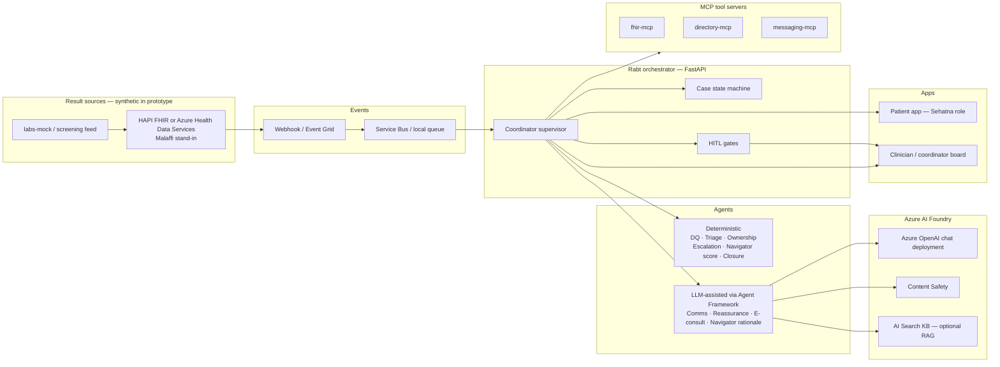
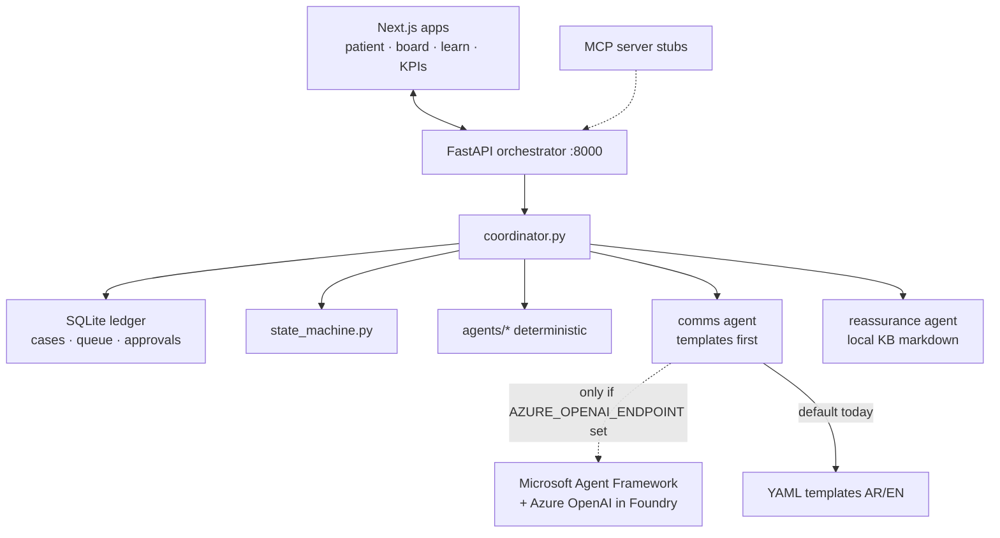
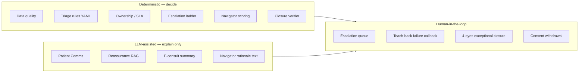
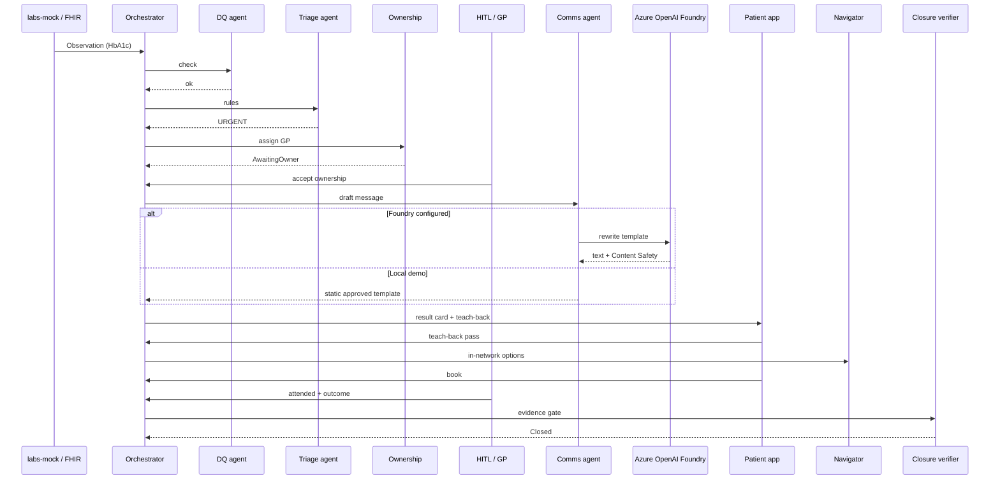

# Rabt architecture

## Image exports (for deck / README)

| Diagram | PNG |
|---|---|
| A — Target (Azure / Foundry) | [`docs/assets/architecture-target.png`](assets/architecture-target.png) · also `architecture.png` |
| B — As-built local demo | [`docs/assets/architecture-asbuilt.png`](assets/architecture-asbuilt.png) |
| C — Agent split | [`docs/assets/architecture-agent-split.png`](assets/architecture-agent-split.png) |
| D — SC-01 sequence | [`docs/assets/architecture-sequence-sc01.png`](assets/architecture-sequence-sc01.png) |

Source `.mmd` files sit next to the PNGs if you need to re-render: `npx @mermaid-js/mermaid-cli -i file.mmd -o file.png -b white -s 2`

---

**Stack honesty for the deck / judges**

| Layer | What Rabt uses | What we do **not** use |
|---|---|---|
| Orchestration | Our **state machine** + **Coordinator** (FastAPI) | LangChain, LangGraph, AutoGen |
| LLM agents (target) | **Microsoft Agent Framework** → **Azure OpenAI in Azure AI Foundry** | OpenAI.com keys as primary; LangChain chains |
| LLM agents (today, local demo) | **Approved templates** (no cloud required). AF+Foundry path is coded but **off** until Azure env vars are set | — |
| Tools | **MCP** servers (`fhir-mcp`, `directory-mcp`, `messaging-mcp`) | Ad-hoc unrestricted tool calling |
| Safety path | Deterministic Python (triage, escalation, closure) — **no LLM** | LLM deciding urgency or closure |
| HITL | `hitl.py` queue + board UI | Fully autonomous close |

> **One line for slides:** *Rabt is a deterministic care-loop workflow; Azure AI Foundry (via Microsoft Agent Framework) is used only to draft patient-facing text inside guardrails — not to decide triage, escalation, or closure.*

---

## A. Target architecture (submission / Azure)

Use this diagram in the deck. It matches the solution plan (§5).

---

## B. As-built today (local demo — what you can run now)

**Default path today:** no LangChain, no Foundry call — templates + deterministic agents.  
**Foundry path:** set `AZURE_OPENAI_ENDPOINT` + `AZURE_OPENAI_MODEL` (+ Content Safety); `comms/agent.py` uses `agent_framework.Agent` + `OpenAIChatClient`.

---

## C. Agent split (important for judges)

---

## D. One case through the system (SC-01)

---

## E. File map

| Box on diagram | Code |
|---|---|
| State machine | `services/orchestrator/app/state_machine.py` |
| Supervisor | `services/orchestrator/app/coordinator.py` |
| Delegation contracts | `services/orchestrator/app/contracts.py` |
| HITL | `services/orchestrator/app/hitl.py` |
| Deterministic agents | `services/agents/{triage,data_quality,ownership,escalation,navigator,closure}/` |
| Foundry hook (optional) | `services/agents/comms/agent.py` → `agent_framework` |
| Reassurance (local KB) | `services/agents/reassurance/agent.py` + `data/kb/` |
| MCP | `mcp-servers/*/` |
| UI | `apps/web/` |

---

## F. What to say if asked “Are you on Foundry or LangChain?”

> We do **not** use LangChain. The product orchestration is our own FHIR-aligned state machine. For generative steps we use the **Microsoft Agent Framework** pointing at **Azure OpenAI hosted in Azure AI Foundry**, with Content Safety. Safety-critical steps (triage, escalation, closure) stay deterministic Python so an LLM cannot falsely close a case or miss a critical result. The local prototype runs fully on templates so judges can demo without cloud keys; Foundry lights up when Azure credentials are provided.
