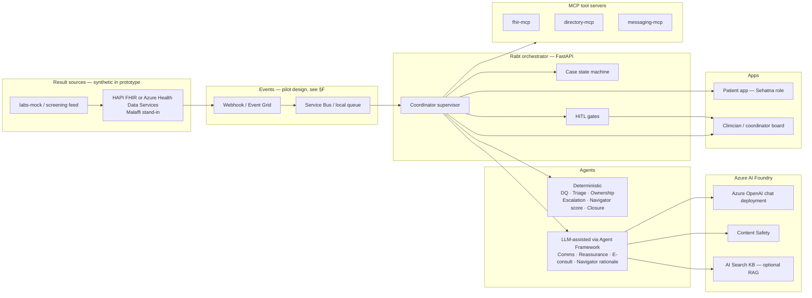
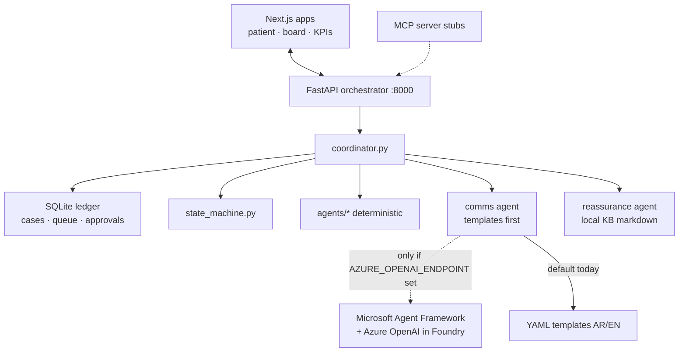
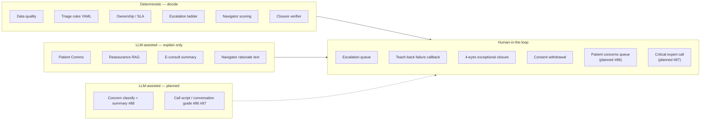
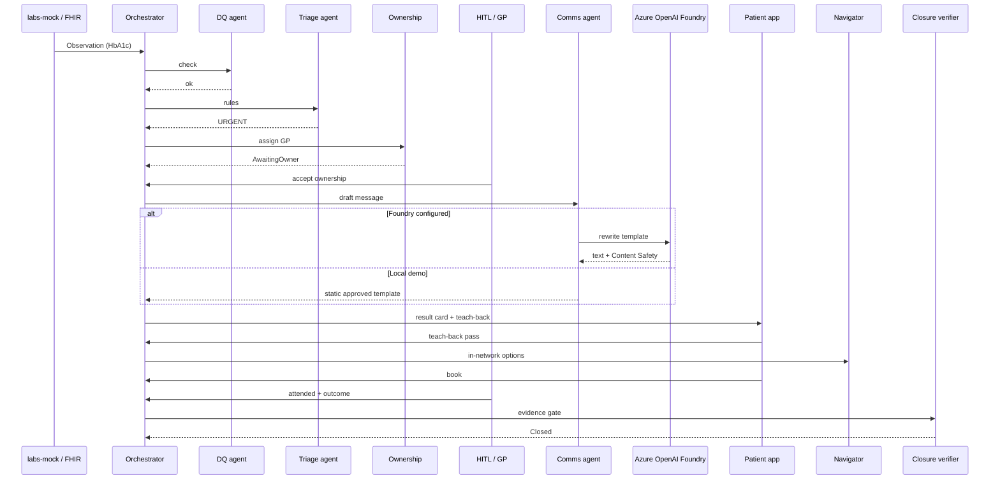
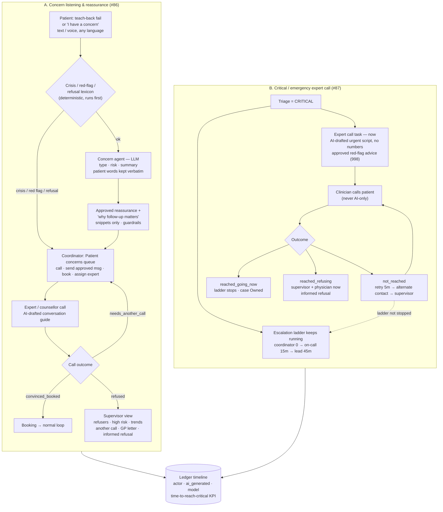
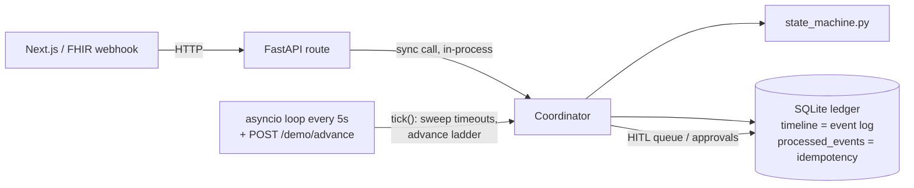
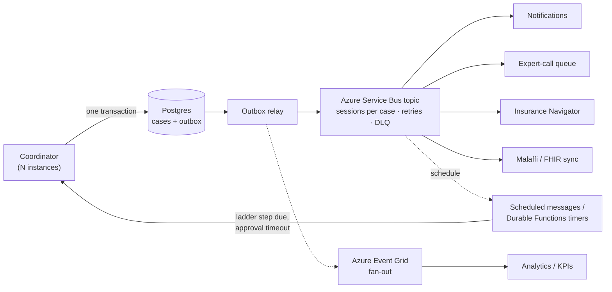

# Rabt architecture

## Image exports (for deck / README)

| Diagram | PNG |
|---|---|
| A — Target (Azure / Foundry) | [`docs/assets/architecture-target.png`](assets/architecture-target.png) · also `architecture.png` |
| B — As-built local demo | [`docs/assets/architecture-asbuilt.png`](assets/architecture-asbuilt.png) |
| C — Agent split | [`docs/assets/architecture-agent-split.png`](assets/architecture-agent-split.png) |
| D — SC-01 sequence | [`docs/assets/architecture-sequence-sc01.png`](assets/architecture-sequence-sc01.png) |
| E — Concern & expert-call loop (planned) | [`docs/assets/architecture-hitl-concern-loop.png`](assets/architecture-hitl-concern-loop.png) |
| F — Eventing today | [`docs/assets/architecture-eventing-today.png`](assets/architecture-eventing-today.png) |
| F — Eventing pilot (design only) | [`docs/assets/architecture-eventing-pilot.png`](assets/architecture-eventing-pilot.png) |

Source `.mmd` files sit next to the PNGs if you need to re-render: `npx @mermaid-js/mermaid-cli -i file.mmd -o file.png -b white -s 2`

---

**Stack honesty for the deck / judges**

| Layer | What Rabt uses | What we do **not** use |
|---|---|---|
| Orchestration | Our **state machine** + **Coordinator** (FastAPI) | LangChain, LangGraph, AutoGen |
| LLM agents (target) | **Microsoft Agent Framework** → **Azure OpenAI in Azure AI Foundry** | OpenAI.com keys as primary; LangChain chains |
| LLM agents (today, local demo) | **Approved templates** (no cloud required). AF+Foundry path is coded but **off** until Azure env vars are set | — |
| Tools | **MCP** servers (`fhir-mcp`, `directory-mcp`, `messaging-mcp`) | Ad-hoc unrestricted tool calling |
| Safety path | Deterministic Python (triage, escalation, closure) — **no LLM** | LLM deciding urgency or closure |
| HITL | `hitl.py` queue + board UI | Fully autonomous close |

> **One line for slides:** *Rabt is a deterministic care-loop workflow; Azure AI Foundry (via Microsoft Agent Framework) is used only to draft patient-facing text inside guardrails — not to decide triage, escalation, or closure.*

---

## A. Target architecture (submission / Azure)

Use this diagram in the deck. It matches the solution plan (§5).

---

## B. As-built today (local demo — what you can run now)

**Default path today:** no LangChain, no Foundry call — templates + deterministic agents.  
**Foundry path:** set `AZURE_OPENAI_ENDPOINT` + `AZURE_OPENAI_MODEL` (+ Content Safety); `comms/agent.py` uses `agent_framework.Agent` + `OpenAIChatClient`.

---

## C. Agent split (important for judges)

Dashed / "planned" boxes are not built yet. Full list of human inputs and who can use them: [hitl-playbook.md](hitl-playbook.md).

---

## D. One case through the system (SC-01)

---

## E. Human-in-the-loop: concern, reassurance and expert-call loop

**Status: design, not built yet.** Tracked in #86 (concern loop), #87 (critical expert call), #85 (HITL gaps) and #52 (roles). Today only the teach-back failure callback and the critical escalation ladder exist.

Rules that do not change: the LLM only classifies, summarises and drafts from approved content; it never sets urgency, never lowers deterministic urgency, never stops the ladder and never closes a case. Closure still needs evidence or two-person approval.

---

## F. Eventing: demo today vs pilot

### Today (as built)

- **No message bus.** FastAPI routes call `Coordinator` methods directly and synchronously, in the same process (`services/orchestrator/app/main.py` → `coordinator.py`).
- **SQLite ledger is the event log.** Every transition appends to the case `timeline_json` / `provenance_json`; webhook ingest is de-duplicated through `processed_events` (`ledger.py`, `coordinator.py:103`).
- **Time-based events** come from a background loop that calls `coordinator.tick()` every 5 s (`main.py:35-45`) to sweep HITL timeouts and advance the escalation ladder, plus `POST /demo/advance` to move the demo clock.
- **One process on the Render free tier**, one replica (`render.yaml`); the SQLite file is in `/tmp` and is reseeded on every start.
- **Limits:** single instance only; no guaranteed delivery if the process crashes or the free instance sleeps (in-flight work and timers are lost); no fan-out to other consumers; tick errors are swallowed.

### Pilot (planned — design only, not built)

- The coordinator publishes **domain events** — `CaseCreated`, `CaseTriaged`, `CaseEscalated`, `ConcernRaised`, `ExpertCallRequired`, `CallOutcomeLogged`, `CaseClosed`, … — instead of doing all side effects inline.
- **Azure Service Bus** (topics + sessions per case) is preferred for the clinical workflow: ordered per case, retries, dead-letter queue. **Azure Event Grid** for lightweight fan-out (e.g. analytics, FHIR change notifications).
- **Subscribers:** patient notifications (SMS / WhatsApp / app), expert-call queue (#86, #87), Insurance Navigator (#74), analytics / KPIs, Malaffi / FHIR sync.
- **Durable timers** replace the 5 s sweep: Service Bus scheduled messages for ladder steps and approval due times, or Azure Durable Functions timers.
- **Transactional outbox in Postgres:** state change and outgoing event are written in one transaction; a relay publishes the outbox, so nothing is lost if the process dies between commit and publish. Consumers stay idempotent (same idempotency-key idea as `processed_events`).

> Pilot eventing is a design. None of Service Bus, Event Grid, Durable Functions or the outbox exists in the code today.

---

## F2. Navigator payment paths (cashless first, then pay-and-claim)

Each navigator option carries a payment path, computed by rules in `services/agents/navigator/payment.py`:

| Mode | When | Patient pays at visit |
|------|------|-----------------------|
| `cashless` | Provider is in the plan network and bills the insurer directly | Co-pay only |
| `reimbursement` | In-network provider that is not cashless, or an out-of-network provider that accepts self-pay **and** the plan reimburses out-of-network care | Full fee, then claims back `pct` % |
| `self_pay` | Out-of-network, no reimbursement, and the patient explicitly opted in to self-pay | Full fee |

Out-of-network options that are neither reimbursable nor an explicit self-pay opt-in are still excluded.
Score weights are 40 / 20 / 10 for cashless / reimbursement / self-pay, plus distance, earliest slot and language.
Ties break on payment mode, then provider ID, so the ranking is deterministic. The LLM can only write rationale text.

After ranking, the coordinator asks the Demo Health Insurance agent (`payment_options` A2A skill) whether the top option is cashless or reimbursable and stores the reply in `evidence.payment_options`.
Booking a pay-and-claim option opens a **claim task** on the case (`evidence.claim`). The task lists the documents, the claim window and the expected amount back.
The claim moves through `not_started → documents_ready → submitted → approved | rejected → paid` (`POST /cases/{id}/claim`).
The patient handles the paperwork steps. On `submitted` the insurer agent's `claim_submit` skill returns a reference, and staff record the insurer decision.

## G. File map

| Box on diagram | Code |
|---|---|
| State machine | `services/orchestrator/app/state_machine.py` |
| Supervisor | `services/orchestrator/app/coordinator.py` |
| Delegation contracts | `services/orchestrator/app/contracts.py` |
| HITL | `services/orchestrator/app/hitl.py` |
| Deterministic agents | `services/agents/{triage,data_quality,ownership,escalation,navigator,closure}/` |
| Foundry hook (optional) | `services/agents/comms/agent.py` → `agent_framework` |
| Reassurance (local KB) | `services/agents/reassurance/agent.py` + `data/kb/` |
| MCP | `mcp-servers/*/` |
| UI | `apps/web/` |

---

## H. What to say if asked “Are you on Foundry or LangChain?”

> We do **not** use LangChain. The product orchestration is our own FHIR-aligned state machine. For generative steps we use the **Microsoft Agent Framework** pointing at **Azure OpenAI hosted in Azure AI Foundry**, with Content Safety. Safety-critical steps (triage, escalation, closure) stay deterministic Python so an LLM cannot falsely close a case or miss a critical result. The local prototype runs fully on templates so judges can demo without cloud keys; Foundry lights up when Azure credentials are provided.
