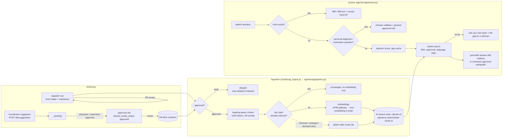

# Knowledge base and RAG pipeline

Rabt answers patient questions only from a reviewed knowledge base (KB). This page covers the KB format, the ingestion pipeline, retrieval, the answer guardrails and the offline evaluation. Azure wiring (APIM, AI Search, the ingestion job) is in [rag-azure.md](rag-azure.md).

> **All KB content is simulated demo content, not medical advice.** It was written for this prototype. Every doc says so in its front matter (`source`) and in a footer line. "Demo Health Insurance" is fictional.

## Pipeline



Offline (tests, template demo, no Azure): the same pipeline writes to a JSON file index with a deterministic hashing embedder, and retrieval uses BM25 over the same approved chunks.

## KB documents

Each file in `data/kb/` starts with YAML front matter:

```yaml
---
id: fit_positive
title: 'Positive FIT result: what it means'
language: en                      # en | ar
topic: screening-colorectal
audience: patient
clinical_review_status: approved  # approved | draft; only approved is ever indexed or retrieved
reviewer: human:gp-aisha
version: 3
last_reviewed: '2026-11-16'
source: simulated demo content, not medical advice
---
```

Current set: 40 docs (38 approved, 2 drafts). Drafts exist to prove the filter.

| Topic | EN | AR |
|---|---|---|
| screening-colorectal (FIT positive / negative, sample collection, after a positive FIT) | 4 | 2 |
| screening-breast (mammogram categories, recall) | 2 | 1 |
| screening-cervical (HPV / smear results, colposcopy) | 1 | 1 |
| screening-metabolic (HbA1c) | 1 | 1 |
| procedure-prep (colonoscopy prep, fasting, Ramadan) | 2 + 1 draft | 1 |
| booking (book, reschedule, cancel, what to bring) | 1 | 1 |
| insurance: Demo Health Insurance (cashless vs reimbursement, pre-approval, co-pay, claim documents, appeals, paying) | 6 + 1 draft | 3 |
| rights-privacy (patient rights, privacy and consent) | 2 | 1 |
| reassurance (anxiety) | 1 | 1 |
| emergency (998 ambulance, 999 police, 997 civil defence) | 1 | 1 |
| escalation (nurse / doctor callback) | 1 | 1 |
| teach-back | 1 | 1 |
| **Total approved** | **23** | **15** |

Languages are English and Arabic, the two languages the translation layer (`agents/translation.py`) and the answer templates support. Hindi, Urdu, Tagalog and Malayalam docs are not included yet: add them when the translation layer and the crisis / clinician templates support those languages, otherwise a patient could get a KB answer with English-only safety text.

Docs approved in the app (learning loop) are written with the same front matter. Older docs with an `<!-- approved_by: ... -->` comment still count as approved; a doc with no metadata at all counts as a draft.

## Chunking

`agents/rag/chunking.py`:

- Splits the body by markdown headings. Every chunk starts with its heading path (`Title > Section`), so it reads well on its own and ranks on the section name.
- Packs paragraphs up to **320 estimated tokens** per chunk. Long paragraphs are split by sentence.
- Carries up to **48 tokens** of trailing sentences into the next chunk of the same section, never across sections.
- Token counts are estimated without a tokenizer (about 1.3 tokens per Latin word and 2.5 per Arabic word), which is close to `cl100k` for this content.

Current KB: 119 chunks, 32 to 183 tokens each (mean 78).

## Ingestion

`scripts/rag_ingest.py` is the CLI around `agents/rag/pipeline.py`.

```bash
python scripts/rag_ingest.py                      # dry run: plan only, no network
python scripts/rag_ingest.py --offline            # local index .kb-index/rabt-kb-v2.json, hashing embedder
python scripts/rag_ingest.py --apply              # Azure AI Search (az login or managed identity)
python scripts/rag_ingest.py --from-blob --apply  # plus docs approved in the app (what the ingestion job runs)
```

- **Approved only.** Drafts are skipped. If a doc is demoted to draft or deleted, its chunks are removed from the index. Queries also filter on `approved eq true`, as defence in depth.
- **Idempotent upsert.**
  - Chunk ids are deterministic (`<doc_id>--<n>`), and every row carries the doc's content hash.
  - Unchanged docs are not re-embedded or re-uploaded.
  - A changed doc is re-uploaded, and chunk ids it no longer produces are deleted.
  - Running twice uploads and deletes nothing.
- **Embeddings through APIM.**
  - With `LLM_BASE_URL` set (Terraform sets it on the ingestion job), embeddings go through the APIM AI gateway with the `kb-ingest` task header, so they get the same metrics, quotas and backend failover as the API.
  - Without it, they go straight to Azure OpenAI with Entra ID.
- **Versioned index.**
  - The index name carries the schema version: `rabt-kb-v2`, with metadata fields `topic`, `audience`, `clinical_review_status`, `version`, `last_reviewed`, `heading` and `tokens`.
  - A schema change means a new index name. Build it, switch `AZURE_SEARCH_INDEX` (Terraform `search_index_name`), then delete the old index.

## Retrieval filters

Azure AI Search and the local retriever apply the same filter:

```
approved eq true and language eq '<en|ar>' [and topic eq '<topic>'] [and audience eq '<audience>']
```

Local results are de-duplicated to one chunk per doc, so the top three hits are three different sources.

## Answer guardrails

These rules are deterministic and run before any retrieval or model call:

| Question | Behaviour |
|---|---|
| Crisis words (chest pain, can't breathe, heavy bleeding, fainted, self-harm; EN and AR) | Urgent-help text with **998** (ambulance) and **999** (police), plus a human hand-off (`HumanCallback`) |
| Personal diagnosis or medication ("Do I have cancer?", "Should I stop my blood thinner?") | Clinician callback, plus the most relevant approved general info with its citation. The KB never answers it. |
| Prompt injection | Refuse and hand off |

After these rules: grounded answer with citations (AI on), or the best approved paragraph (AI off). See [rag-azure.md](rag-azure.md).

## Evaluation

`data/kb_eval/rag_eval.yaml` holds:

- 44 retrieval questions (30 EN, 14 AR), each with the doc ids that count as a correct source;
- 10 must-escalate questions, each with the expected rule;
- the draft ids that must never be returned.

```bash
python scripts/rag_eval.py          # exit 1 if hit@3 < 0.9, any escalation fails, or a draft leaks
```

Offline results (local BM25, AI off):

| Set | n | hit@1 | hit@3 | MRR |
|---|---|---|---|---|
| All | 44 | 0.93 | 1.00 | 0.96 |
| English | 30 | 0.90 | 1.00 | 0.94 |
| Arabic | 14 | 1.00 | 1.00 | 1.00 |
| Must-escalate | 10 | pass rate 1.00 | | |
| Drafts leaked | 0 | | | |

The eval set was written alongside the docs, so these numbers are an optimistic regression baseline, not a measure of real-world quality. `services/orchestrator/tests/test_kb_pipeline.py` runs the same evaluation in CI (hit@3 ≥ 0.9, hit@1 ≥ 0.8, all escalations pass, no drafts).

Arabic retrieval uses light normalisation (alef and ta-marbuta forms, clitic prefixes such as `ال` / `و` / `ب`, and pronoun suffixes). Without it, Arabic hit@3 was 0.79.

## Incremental indexing: push pipeline, not an indexer

Ingestion (`caj-rabt-ingest-pilot`, hourly) is a **push** pipeline with change and delete tracking: every chunk carries its document's content hash, unchanged documents are skipped (no embedding cost), changed or demoted (no longer approved) documents have their old chunks deleted and new ones uploaded, and removed documents are deleted from the index. We deliberately do not use an AI Search blob indexer + skillset here, because three gates must run **before** anything is indexed and an indexer cannot enforce them: clinician approval (front matter), the document safety gate (`docs/document-safety.md`) and the planted-instruction check. Quarantined documents are listed in the ingest report under `quarantined`.
